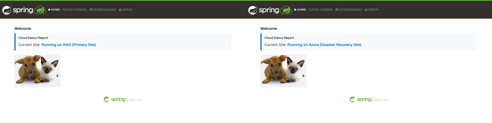

# Multi-Cloud DR — Spring PetClinic (AWS Primary → Azure DR)

AWS를 주 사이트, Azure를 재해 복구(DR) 사이트로 두고 Spring PetClinic 서비스를 이어 가는 멀티클라우드 DR 프로젝트입니다.
인프라는 Terraform(IaC)으로 만들고, DB는 AWS DMS로 RDS MySQL에서 Azure MySQL로 복제하며, 장애가 나면 애플리케이션을 Azure 쪽으로 전환합니다.

> 상태: 2025-12 1차 구현 → **2026-11 재시연 준비 중** (아래 로드맵)

## 출처와 역할

- **애플리케이션**: [Spring PetClinic](https://github.com/spring-projects/spring-petclinic) 공식 샘플(Apache-2.0, `app/LICENSE.txt`)을 기반으로 했습니다. 앱 코드는 Spring 팀의 것이며, 이 레포에서 바꾼 부분은 DR 프로필(`application-aws.properties`, `application-azure.properties`)과 전환 시 화면 상단 DR 배너입니다.
- **인프라·DR 구성**: 팀 프로젝트(2025-12)로 진행했습니다. AWS·Azure Terraform 코드, DMS 복제 구성, 장애 전환 절차를 완성 했습니다. 이 레포는 그 작업을 개인 포트폴리오용으로 다시 정리한 것입니다.

## 2026-11 개인 재현 — 자동 전환과 RTO · RPO 측정

[](dr-local/media/dr_demo_2x.mp4)

같은 구조를 Docker 로 다시 만들고(클라우드 비용 0), 수동 전환을 자동화해 실제로 측정했다. 앱 코드는 고치지 않았다. → **[`dr-local/`](dr-local/README.md)**

| RTO | RPO | 전환 중 실패한 쓰기 |
|---|---|---|
| **18.7초** (재실행 20.8 · 25.2 · 30.6초) | **0건** / 성공 응답 105건 | 27건 / 132건 |

재현하면서 찾은 것: `aws` 프로필만으로는 빈 DB 에서 앱이 뜨지 않음(H2 스키마 실행), 복제만으로는 DMS 를 대신할 수 없음(full load → CDC 순서 필요), 진입점 프록시의 Host 헤더 누락. 시연 영상은 실제 화면 녹화다.

## 구조

```
infra/
  aws/      Terraform — VPC(2 AZ, NAT HA), Bastion, EC2, RDS MySQL, Security Group, SSM/Secrets
  azure/    Terraform — VNet, Bastion, Azure Database for MySQL Flexible Server
            (Private DNS, GTID on → DMS 복제 대상)
app/        Spring PetClinic + DR 프로필 (aws / azure) · 전환 시 화면 상단 DR 배너
docs/       구현 근거, 마이그레이션 가이드, 발표 자료, AWS 인프라 상세
```

## 아키텍처

```
          ┌──────────── AWS (Primary) ────────────┐        ┌──────────── Azure (DR) ─────────────┐
 User ──▶ │ EC2 (PetClinic, profile=aws)          │        │ VM (PetClinic, profile=azure)        │
          │        │                              │        │        │                             │
          │   RDS MySQL ──── AWS DMS (CDC) ───────┼───────▶│   MySQL Flexible Server (GTID)       │
          └───────────────────────────────────────┘        └──────────────────────────────────────┘
 장애 시: 앱을 azure 프로필로 재기동 → Azure DB로 서비스 계속 (화면에 "Disaster Recovery Site" 배너)
```

## 실행

DB 접속 정보는 코드에 넣지 않고 환경변수로 받습니다.

```bash
cd app && ./mvnw package -DskipTests

# Primary (AWS)
DB_HOST=<rds-endpoint> DB_USERNAME=<user> DB_PASSWORD=<pw> \
  java -jar -Dspring.profiles.active=aws target/*.jar

# Failover (Azure)
DB_HOST=<azure-mysql-host> DB_USERNAME=<user> DB_PASSWORD=<pw> \
  java -jar -Dspring.profiles.active=azure target/*.jar
```

인프라:

```bash
cd infra/aws/environments/dev && terraform init && terraform apply
cd infra/azure && terraform init && terraform apply
# 시연 후 비용 정리
terraform destroy
```

## 재시연 로드맵 (2026-11~)

- [ ] AWS·Azure Terraform 최신 provider로 다시 apply, 변수·tfvars 정리
- [ ] DMS 복제 작업(full load + CDC)을 Terraform으로 코드화
- [x] 수동 전환 → 헬스체크 기반 자동 전환 — **로컬 재현 완료** (`dr-local/failover.sh`). 클라우드 적용(Route 53 / Traffic Manager)은 남음
- [x] RTO/RPO 측정 — **로컬: RTO 18.7초 · RPO 0건** (`dr-local/results_2026-11-16/`). 클라우드 값은 남음
- [x] 시연 영상·스크린샷 (로컬) — 클라우드 비용 기록은 남음
