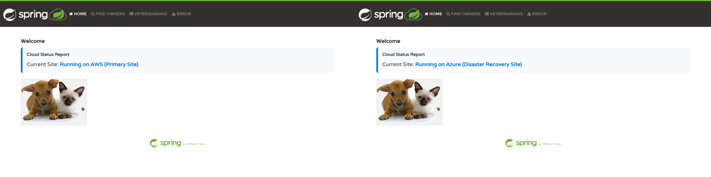

# 로컬 DR 재현 — 자동 전환과 RTO · RPO 측정 (2026-11-16, 개인 작업)

2025-12 팀 프로젝트의 AWS → Azure DR 구조를 **클라우드 비용 없이 Docker 로 같은 모양으로 다시 만들고**, 원래 수동이던 전환을 자동화해 **복구 시간(RTO)과 데이터 손실(RPO)을 실제로 쟀다.** 앱 코드(`../app/`)는 한 줄도 고치지 않았다.

[](media/dr_demo_2x.mp4)

**영상:** [`media/dr_demo_2x.mp4`](media/dr_demo_2x.mp4) (43초, 2배속) · [`media/dr_demo.mp4`](media/dr_demo.mp4) (86초, 실시간) — 가상 화면의 터미널에서 `demo.sh` 가 실제로 도는 모습을 ffmpeg 로 녹화했다.

## 결과 (녹화한 실행, `results_2026-11-16/`)

| 항목 | 값 |
|---|---|
| 장애 감지 | 4.8초 (2초 간격 확인, 3번 연속 실패) |
| DR DB 승격 | 4.9초 |
| **RTO** (장애 주입 → 진입점이 DR 로 응답) | **18.7초** |
| 전환 중 실패한 쓰기 | 27건 / 132건 시도 (사용자는 오류를 봄) |
| **RPO** (성공 응답을 받았는데 DR 에 없는 쓰기) | **0건** / 105건 |
| DR 기동 때 기본 데이터 중복 | 없음 |

같은 시나리오를 녹화 전에 세 번 돌렸을 때 RTO 는 20.8 · 30.6 · 25.2초였다. 대부분 DR 앱(Spring Boot) 기동 시간이다.

## 클라우드 구성과의 대응

| 원래 (클라우드) | 로컬 재현 |
|---|---|
| AWS RDS MySQL | `mysql-primary` (MySQL 8.4, GTID) |
| Azure MySQL Flexible Server | `mysql-dr` (읽기 전용 복제본) |
| AWS DMS (full load + CDC) | 덤프로 full load → GTID 자동 위치 복제 (`setup_replication.sh`) |
| EC2 의 PetClinic (profile aws) | `app-aws` |
| Azure VM 의 PetClinic (profile azure) | `app-dr` — 장애 전까지 꺼 둠(콜드 스탠바이) |
| 사람이 앱을 azure 프로필로 재기동 | **`failover.sh` 가 자동으로**: 감지 → DB 승격 → DR 앱 기동 |
| Route 53 failover | `front` (nginx, 주 서버가 응답 없으면 DR 로) |

## 재현하면서 찾은 것

1. **`aws` 프로필만으로는 빈 MySQL 에서 앱이 뜨지 않는다.** 기본값 `database=h2` 가 남아 H2 용 스키마를 MySQL 에 실행하다 실패한다. 프로필을 `mysql,aws` / `mysql,azure` 로 주면 해결된다(`.env`, 코드 수정 없음). 원래 프로젝트는 DB 에 스키마가 이미 있어서 드러나지 않았을 가능성이 크다.
2. **DMS 역할을 복제만으로 하면 실패한다.** DR DB 가 주 DB 의 초기 설정 기록(사용자 생성)까지 다시 실행하다 멈췄다. DMS 처럼 "한 시점 적재(full load) → 그 뒤 변경만 복제(CDC)" 순서로 해야 한다.
3. **진입점 프록시가 Host 헤더를 넘기지 않으면 등록 뒤 이동(302)이 포트 없는 주소로 가서 사용자가 오류를 본다.** `proxy_set_header Host $http_host` 로 고쳤다.

## 한계

- 클라우드가 아니다. 네트워크 지연, DMS 의 실제 복제 지연, DNS TTL 은 재현하지 않았다. RTO 는 로컬 값이다.
- 장애는 컨테이너 정지 한 종류다. 네트워크 단절, 반쯤 살아 있는 상태(split-brain)는 시험하지 않았다.
- 주 사이트가 돌아왔을 때 되돌리기(failback)는 자동화하지 않았다.
- 비밀번호는 로컬 시연용 고정값이다(`docker-compose.yml`). 클라우드에서는 원래 프로젝트처럼 환경변수·비밀 저장소로 받는다.

## 따라 하기 (Git Bash)

```bash
cd dr-local
docker build -t petclinic-dr -f Dockerfile.app ..     # 앱 이미지 (첫 빌드 약 5분)
bash reset.sh                                         # 정상 상태: 주 사이트 + DR DB 복제   → ready
PY=python bash demo.sh                                # 시나리오 실행 (약 80초) — Linux·macOS 는 PY 생략
bash record.sh                                        # (선택) 화면 녹화 → media/dr_demo*.mp4
docker compose --profile dr down -v                   # 정리
```
`demo.sh` 마지막에 감지 · 승격 · RTO · 실패 쓰기 · RPO 가 출력되고 `run/result.txt` 에 저장된다.

| 파일 | 역할 |
|---|---|
| `docker-compose.yml` · `front.conf` · `.env` | 구성 (DB 2 · 앱 2 · 진입점) |
| `setup_replication.sh` | full load + CDC 복제 |
| `failover.sh` | 자동 전환 (단계별 시각 기록) |
| `load.py` | 사용자 쓰기 부하 (성공 응답 받은 쓰기만 기록 → RPO 대조) |
| `demo.sh` · `reset.sh` · `record.sh` | 시나리오 · 초기화 · 녹화 |
